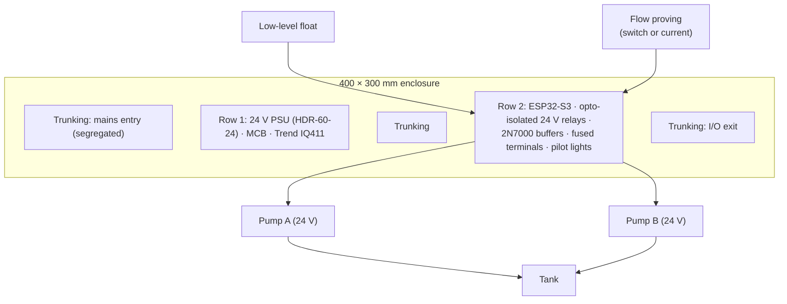
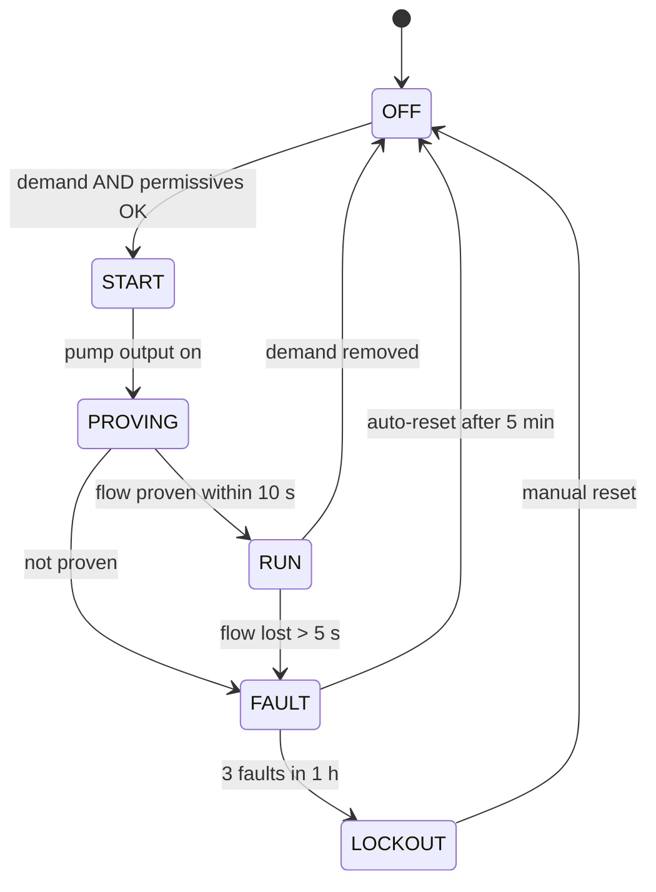

# DIN-Rail Training Rig: Duty/Standby Pump Rotation and Interlocks (In Progress)

**Two classic BMS plant sequences built on a physical DIN-rail training rig with real 24 V pumps: duty/standby rotation with run-hour balancing and automatic failover, and a state machine with permissives, proving and lockouts. The same sequences are later re-implemented on the rig's Trend IQ411 and in a PLC environment for comparison.**

> **The short version:**
> - **The rig:** a 400 × 300 mm enclosure; row 1 holds a 24 V PSU (HDR-60-24), MCB and a Trend IQ411; row 2 is a rotating zone with an ESP32-S3 and opto-isolated 24 V relays driving **two brushless 24 V submersible pumps**.
> - **Duty/standby (#7):** lead/lag rotation by run hours or weekly, failover on a proving failure, alarms, and a manual override.
> - **Interlocks (#9):** a pump state machine (OFF → START → PROVING → RUN → FAULT/LOCKOUT) with permissives (low-level dry-run protection, hand/off/auto), proving within a time window, and a latched lockout with a reset.
> - **Why it matters:** the same interlock thinking guards the OpenTherm changeover on the real boiler.

**Portfolio position:** Automation level · plant sequences (portfolio #7 and #9). Re-implemented in: [Trend IQ411](https://github.com/the-control-cabinet/trend-iq411-commissioning) · [PLC (IEC 61131-3)](https://github.com/the-control-cabinet/plc-reimplementation-iec61131). Rig companions: [PID rig exercise](https://github.com/the-control-cabinet/pid-anti-hunt-control-rig) (#8) · [Trend IQ411](https://github.com/the-control-cabinet/trend-iq411-commissioning) (#12). Applied later in: [OpenTherm changeover interlock](https://github.com/the-control-cabinet/opentherm-boiler-control-esphome)

---

## Status at a glance

| Item | Status |
|---|---|
| Enclosure, row 1 (24 V PSU, MCB, Trend IQ411) | ✅ Built |
| Row 2 (ESP32-S3, opto relays, 2N7000 buffers, fused terminals, pilot lights) | 🚧 Wiring in progress |
| Two 24 V brushless submersible pumps, tank, DS18B20 probes | ✅ In hand |
| Flow proving and low-level float | ⏳ To add |
| Duty/standby and state machine written ([docs 02-03](docs/02-duty-standby.md)); test record T1-T5 ([data](data/test-record.csv)) | 📐 Designed; tests to run |

## Why a rig

Duty/standby pumps and their interlocks are bread-and-butter BMS: almost every plant room has a pair of pumps that must share run hours, fail over automatically and never run dry. The rig makes those sequences real (with real 24 V pumps, a real tank and real permissives) so they can be tested by forcing faults, then **re-implemented on a Trend IQ411 and in a PLC** and compared against the same test record.

## The rig

## Duty/standby (#7)

| Function | Rule |
|---|---|
| Lead selection | Lowest run hours becomes lead at each rotation; weekly or every N run hours |
| Start | On demand, start the lead; prove flow within 10 s |
| Failover | Lead fails to prove → FAULT (P2) → start the lag automatically |
| Both failed | P1: no pump available |
| Exercise | Each idle pump runs 30 s weekly (anti-seize) |
| Manual | Hand/off/auto per pump; hand bypasses rotation but **never** the safety permissives |
| Records | Run hours, starts and faults per pump; rotation log |

## Pump state machine and interlocks (#9)

| Permissive | Effect if lost |
|---|---|
| Low-level float OK | Immediate stop (dry-run protection), alarm |
| Mode = AUTO | No automatic start |
| No lockout | No start until reset |

## Test record

| Test | From state | Action | Expected |
|---|---|---|---|
| T1 | OFF | Demand on | Lead starts, then RUN |
| T2 | PROVING | Block flow | FAULT, then the lag starts |
| T3 | RUN | Low level lost | Immediate stop + alarm |
| T4 | FAULT ×3 | Repeat | LOCKOUT |
| T5 | LOCKOUT | Manual reset | OFF |

Every transition is forced and observed, and every permissive removed in every state. The **same T1-T5** are run on the Trend and PLC versions, so the platforms are compared on identical tests.

## Safety

- Mains segregated at the top, I/O at the bottom; the 24 V side fused per circuit.
- Pumps never run dry: the low-level permissive, hardwired where possible.

**Where this thinking goes next:** the OpenTherm changeover on the real boiler uses the same interlock pattern (permissives, proving, latched fault, manual reset) to fall back safely to Evohome control.

## Documents

| Doc | Contents |
|---|---|
| [01 The rig](docs/01-rig.md) | Layout, power, I/O, safety |
| [02 Duty/standby sequence (#7)](docs/02-duty-standby.md) | Rotation, failover, run-hour balancing |
| [03 Interlocks and state machine (#9)](docs/03-interlocks-state-machine.md) | States, permissives, proving, lockout |

## Roadmap
- [ ] Complete row 2 wiring (relays, pilot lights, fused terminals)
- [ ] Add flow proving and a low-level float
- [ ] Duty/standby live on the ESP32 with run-hour records
- [ ] State machine and permissive tests recorded
- [ ] Re-implement on the Trend IQ411 and in CODESYS; compare

## Skills demonstrated (as built)
| Skill | Evidence |
|---|---|
| Plant sequences | Duty/standby with failover and run-hour balancing |
| Interlocks | State machine with permissives, proving, lockout |
| Panel building | DIN-rail layout, segregation, fusing |
| Testing | Forced transitions and permissive tests recorded |

📺 [The Control Cabinet on YouTube](https://www.youtube.com/channel/UC5Cupmz7vlfcodpCX7k8iuQ)

*Built and documented by James · part of [The Control Cabinet BMS portfolio](https://github.com/the-control-cabinet/the-control-cabinet). MIT Licence.*
