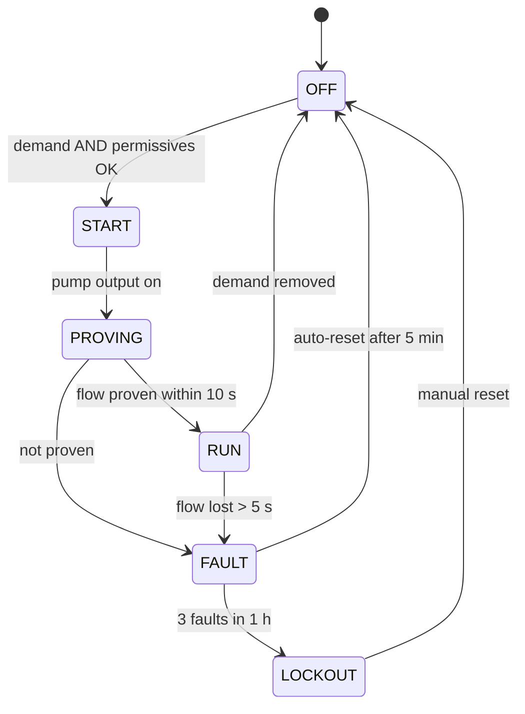

# 03 Interlocks and state machine (#9)

[← Back to README](../README.md)

| Permissive | Effect if lost |
|---|---|
| Low-level float OK | Immediate stop (dry-run protection), alarm |
| Mode = AUTO | No automatic start |
| No lockout | No start until reset |

**Test plan:** each transition forced and observed; each permissive removed in each state; logged in [data/test-record.csv](../data/test-record.csv).
